<p align="center">
  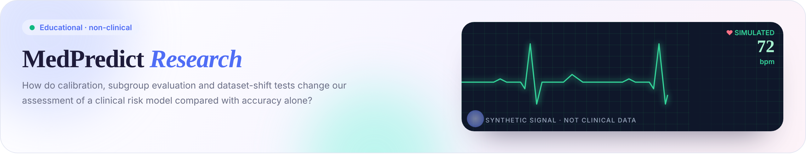
</p>

<h1 align="center">MedPredict Research</h1>
<p align="center"><b>Reliable, calibrated & explainable healthcare risk prediction</b><br/>
Studies whether a tabular clinical risk model is accurate, calibrated, interpretable and stable across subgroups and
changing data conditions — instead of stopping at accuracy.</p>

<p align="center">
  <a href="https://github.com/YOUR-GITHUB-USERNAME/medpredict-research/actions/workflows/ci.yml"></a>
  
  
  
  
  
  
</p>

<p align="center">
  <a href="#-highlights">Highlights</a> · <a href="#-results">Results</a> · <a href="#-screenshots">Screenshots</a> ·
  <a href="#-quick-start">Quick start</a> · <a href="#-api">API</a> · <a href="#-how-it-works">How it works</a> ·
  <a href="#%EF%B8%8F-limitations">Limitations</a>
</p>

> ## ⚕️ Safety boundary
> **Educational research prototype — not a diagnostic device, clinical decision system or substitute for a licensed
> clinician. Do not use it to make real patient-care decisions.** All data is synthetic and de-identified; the dashboard
> and API never display a diagnosis or treatment recommendation.

---

## ✨ Highlights
- **Leakage enforced by tests:** post-outcome columns are present in the raw data on purpose and a unit test fails if they ever become features.
- **Temporal + patient-level split:** no patient appears in two splits; the test period is later in time.
- **3 models × 3 calibration methods:** logistic regression, random forest, gradient boosting × none / Platt / isotonic — selected on **validation** log loss.
- **Beyond AUROC:** Brier, log loss, ECE, calibration slope, reliability diagrams, sensitivity/specificity at a stated research threshold.
- **Subgroups with sample sizes and CIs:** sex, age band, site — groups under n = 50 are suppressed, not over-interpreted.
- **Shift tests:** injected lab missingness, older / higher-glucose populations, an unseen hospital site, and a later time period.
- **Uncertainty:** bootstrap ensemble band shown around every calibrated probability.
- **"Clinical Calm" dashboard:** a light, calm UI with a safety banner on every page.

## 🔬 Research question
> **How do calibration, subgroup evaluation and dataset-shift tests change the assessment of a clinical risk prediction
> model compared with accuracy-only evaluation?**

## 📊 Results
*Synthetic 30-day readmission cohort (≈11 000 encounters, 3 sites, 2022–2025). Later test period.*

| Model | Calibration | AUROC (95 % CI) | Brier | ECE | Cal. slope | Accuracy@0.5 |
|---|---|---|---|---|---|---|
| Logistic regression | none | 0.683 (0.649–0.718) | 0.1939 | 0.042 | 0.90 | 0.708 |
| **Logistic regression** | **isotonic** ← *selected on validation* | 0.678 (0.645–0.712) | 0.1940 | 0.029 | 0.76 | 0.705 |
| Random forest | sigmoid | 0.694 (0.661–0.731) | 0.1906 | 0.023 | 1.03 | 0.713 |
| HistGradientBoosting | none | 0.682 (0.647–0.718) | 0.1958 | **0.058** | 0.76 | 0.705 |
| HistGradientBoosting | isotonic | 0.680 (0.646–0.716) | 0.1947 | 0.017 | 0.67 | 0.714 |

### What accuracy hides
| Finding | Evidence |
|---|---|
| **Accuracy can't separate the models** | Accuracy@0.5 spans 0.705–0.714 while ECE spans 0.017–0.058 |
| **Site transfer breaks calibration** | Unseen site C: ECE **0.161**, mean predicted 0.30 vs observed 0.45 (in-distribution 0.038) |
| **One threshold ≠ equal opportunity** | Sensitivity: age 18–44 → **0.17**, age 80+ → **0.99** at the same threshold |
| **Missingness is tolerated** | AUROC 0.678 → 0.672 with 40 % of lab values removed |
| **Simple model is competitive** | Tree models' AUROC gains lie inside the baseline's bootstrap CI |

<p align="center">
  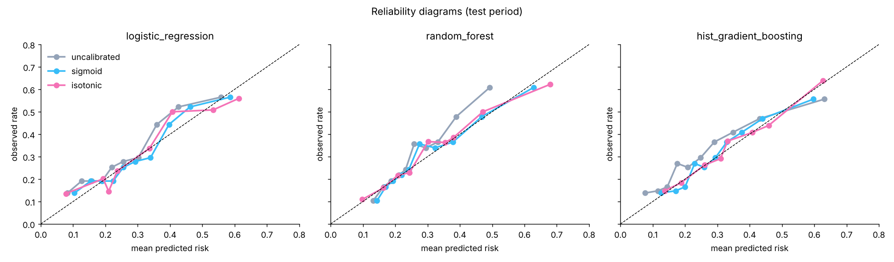
  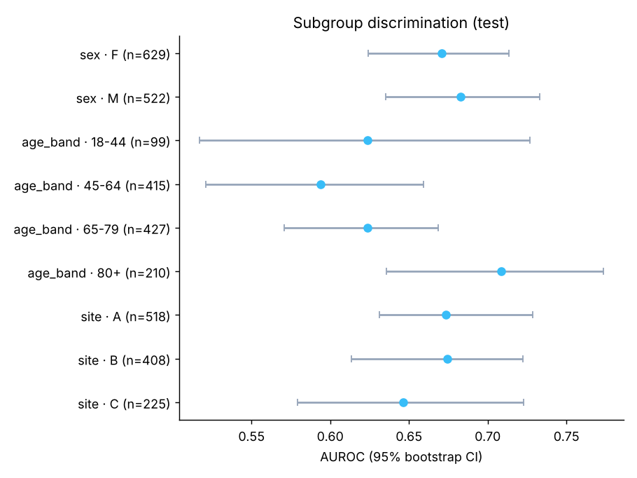
  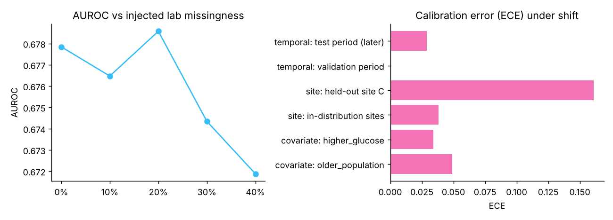
</p>

Full report: [`reports/evaluation_report.md`](reports/evaluation_report.md) · Model card: [`docs/MODEL_CARD.md`](docs/MODEL_CARD.md)

## 📸 Screenshots
<table>
  <tr>
    <td width="50%">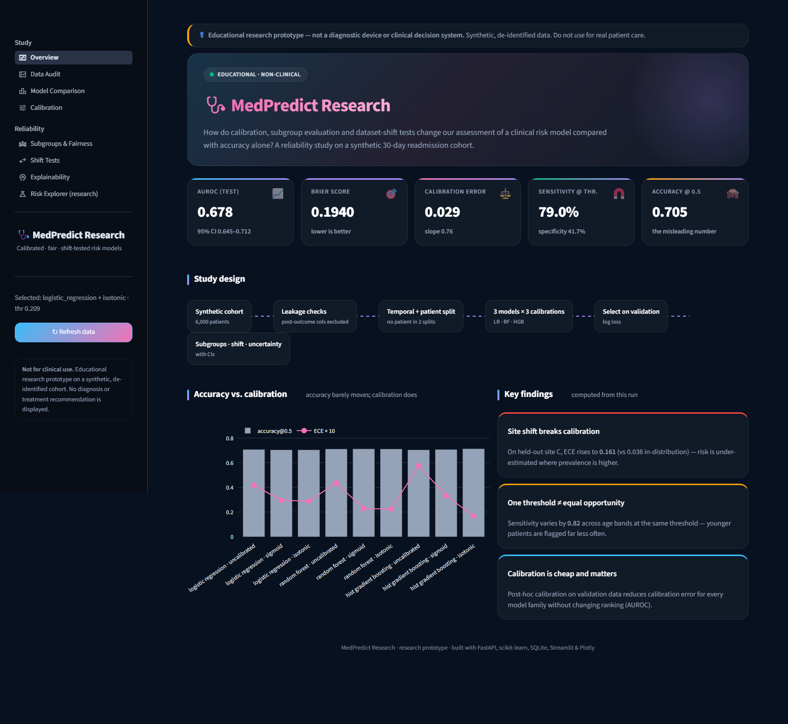<br/><sub><b>Overview</b> — ECG hero, KPIs, accuracy vs calibration, key findings</sub></td>
    <td width="50%">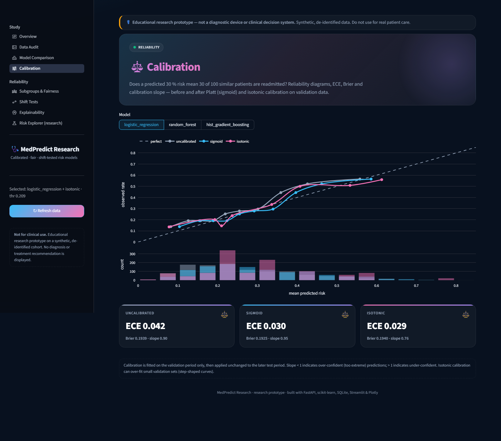<br/><sub><b>Calibration</b> — reliability diagrams with risk histograms</sub></td>
  </tr>
  <tr>
    <td>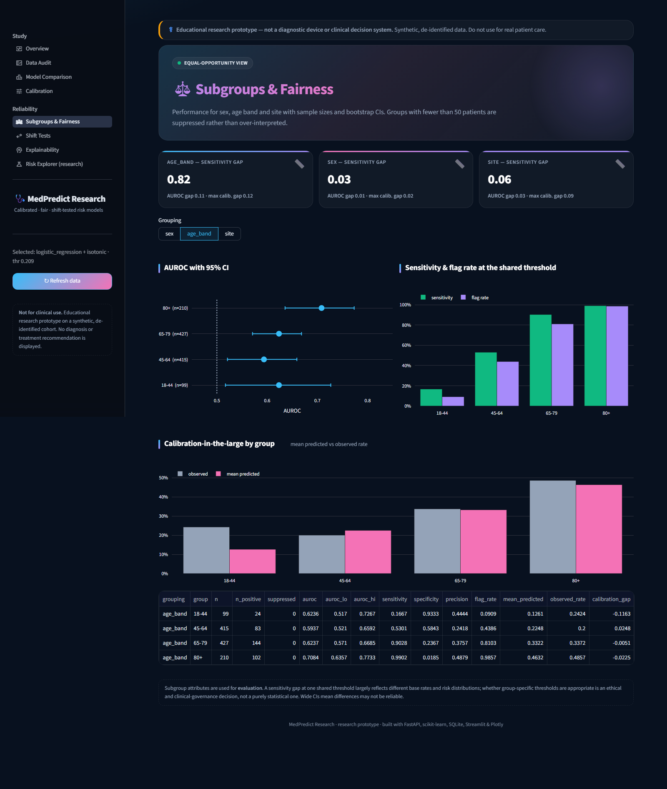<br/><sub><b>Subgroups & Fairness</b> — AUROC CIs, sensitivity, calibration-in-the-large</sub></td>
    <td>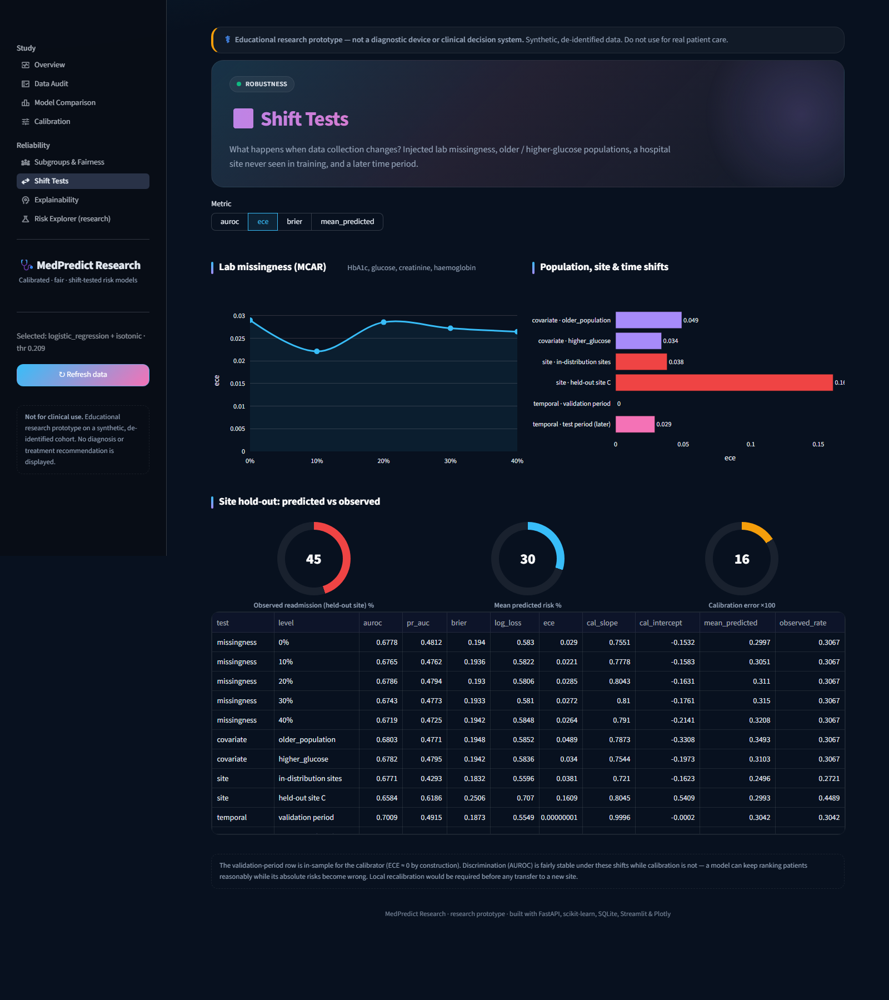<br/><sub><b>Shift Tests</b> — missingness, covariate, site and temporal shift</sub></td>
  </tr>
  <tr>
    <td>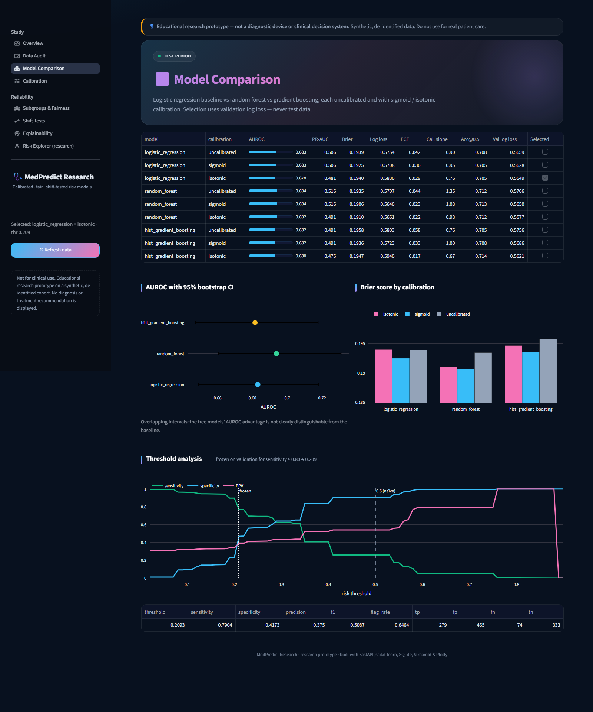<br/><sub><b>Model Comparison</b> — 9 configurations, threshold trade-off</sub></td>
    <td>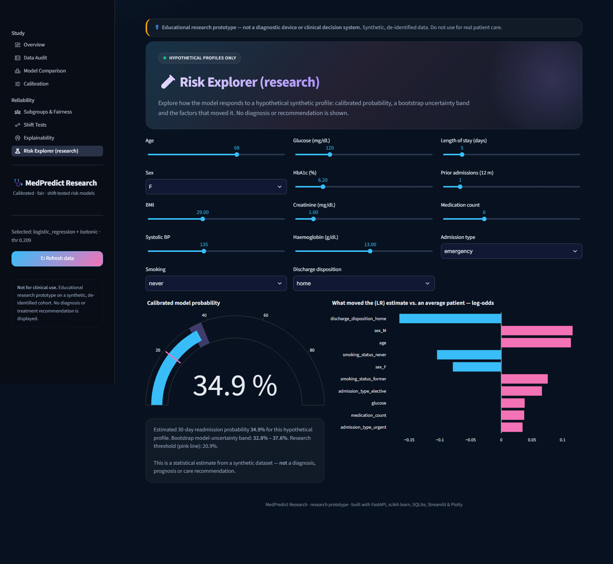<br/><sub><b>Risk Explorer</b> — hypothetical profile, uncertainty band, contributions</sub></td>
  </tr>
  <tr>
    <td>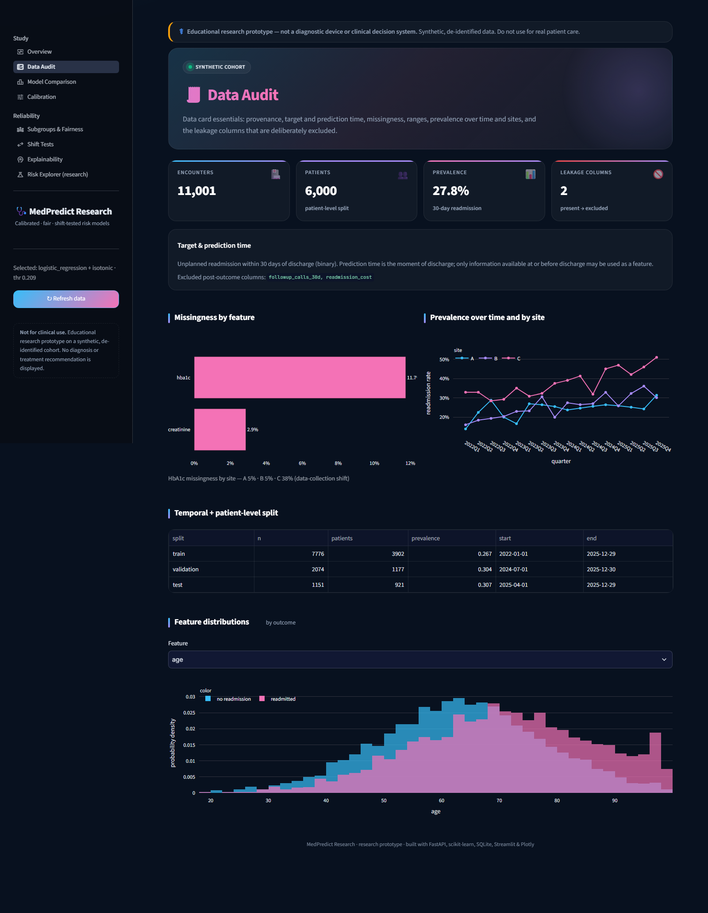<br/><sub><b>Data Audit</b> — target definition, leakage columns, missingness by site</sub></td>
    <td>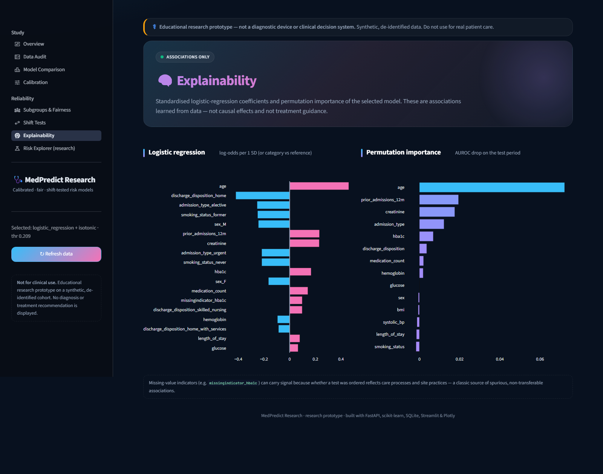<br/><sub><b>Explainability</b> — odds ratios and permutation importance</sub></td>
  </tr>
</table>

## 🚀 Quick start
**Requirements:** Python 3.11 or 3.12 · no GPU.

<details open>
<summary><b>Windows (PowerShell)</b></summary>

```powershell
git clone https://github.com/YOUR-GITHUB-USERNAME/medpredict-research.git
cd medpredict-research
py -3.12 -m venv .venv
.\.venv\Scripts\Activate.ps1
pip install -r requirements-dev.txt
pip install -e .
python -m medpredict.cli pipeline                      # ≈20 s
streamlit run dashboard/app.py --server.port 8504      # → http://localhost:8504
```
</details>

<details>
<summary><b>macOS / Linux</b></summary>

```bash
git clone https://github.com/YOUR-GITHUB-USERNAME/medpredict-research.git && cd medpredict-research
python3.12 -m venv .venv && source .venv/bin/activate
pip install -r requirements-dev.txt && pip install -e .
python -m medpredict.cli pipeline
streamlit run dashboard/app.py --server.port 8504
```
</details>

<details>
<summary><b>Docker</b></summary>

```bash
docker build -f docker/Dockerfile -t medpredict-research .
docker run -p 8003:8003 -p 8504:8504 medpredict-research
```
</details>

**API:** `uvicorn api.main:app --reload --port 8003` → http://localhost:8003/docs

## 🔌 API
| Method | Endpoint | Purpose |
|---|---|---|
| `GET` | `/health` | Status + disclaimer |
| `POST` | `/risk` | Hypothetical profile → probability, uncertainty band, top associations |
| `GET` | `/metrics` | Selected model, test metrics, splits |
| `GET` | `/subgroups` | Subgroup table (with suppression) |
| `GET` | `/shift-tests` | Shift-test results |

```bash
curl -X POST localhost:8003/risk -H "Content-Type: application/json" -d '{"age":68,"hba1c":6.2,"length_of_stay":5}'
```
```json
{ "probability": 0.3487, "uncertainty_band": [0.3282, 0.3761], "research_threshold": 0.209,
  "model": "logistic_regression+isotonic",
  "disclaimer": "Educational research prototype. Not a diagnostic device ..." }
```

## 🏗 How it works
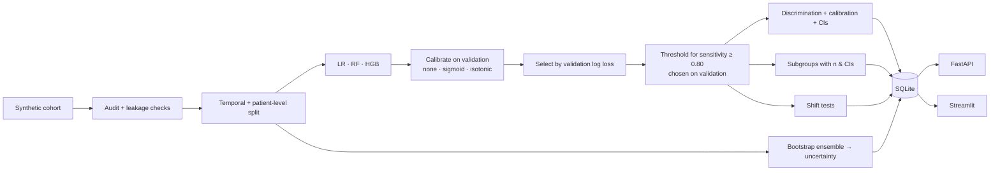
Data card: [`docs/DATA_CARD.md`](docs/DATA_CARD.md)

## 📁 Project structure
```
medpredict-research/
├── configs/              dataset.yaml · target.yaml · evaluation.yaml
├── src/medpredict/
│   ├── data/             synthetic cohort · breast-cancer / CSV loaders · audit
│   ├── preprocessing/    temporal + patient split · leakage checks
│   ├── features/         imputation with missing indicators · scaling · one-hot
│   ├── models/           LR / RF / HGB · bootstrap ensemble
│   ├── calibration/      sigmoid / isotonic · ECE · slope · reliability
│   ├── evaluation/       metrics + CIs · threshold policy · shift tests · figures
│   ├── fairness/         subgroup report with suppression
│   ├── explainability/   coefficients · permutation · local contributions
│   └── storage/          SQLite
├── api/ · dashboard/ ("Clinical Calm" design) · notebooks/ · tests/ (16) · reports/ · scripts/ · docs/ · docker/
```

## ✅ Testing
`pytest -q` — 16 tests: leakage enforcement, patient-level & temporal split, ECE/slope correctness, threshold policy,
calibration monotonicity, subgroup suppression, shift tests, uncertainty band, API safety.

## ⚠️ Limitations
- Synthetic cohort — results have **no** clinical validity; independent clinical validation and governance would be required.
- Subgroup CIs are wide; small groups are suppressed.
- Bootstrap bands cover estimation uncertainty only — not label noise, confounding or shift.
- Explanations are associations in the model, not causal effects.

## 🔗 Related projects
| Project | Focus |
|---|---|
| 🛰️ [SentinelML](https://github.com/YOUR-GITHUB-USERNAME/sentinelml) | Drift monitoring & adaptive retraining |
| 🛡️ [ThreatSense](https://github.com/YOUR-GITHUB-USERNAME/threatsense) | Explainable network anomaly detection |
| 🔬 [VisionGuard AI](https://github.com/YOUR-GITHUB-USERNAME/visionguard-ai) | Robust visual defect inspection |

## 👤 Author
**Padmashree Shah** · [GitHub](https://github.com/YOUR-GITHUB-USERNAME) · [LinkedIn](https://www.linkedin.com/in/YOUR-LINKEDIN)

<sub>MIT licensed · educational, non-clinical research prototype · not affiliated with or endorsed by Microsoft.</sub>
